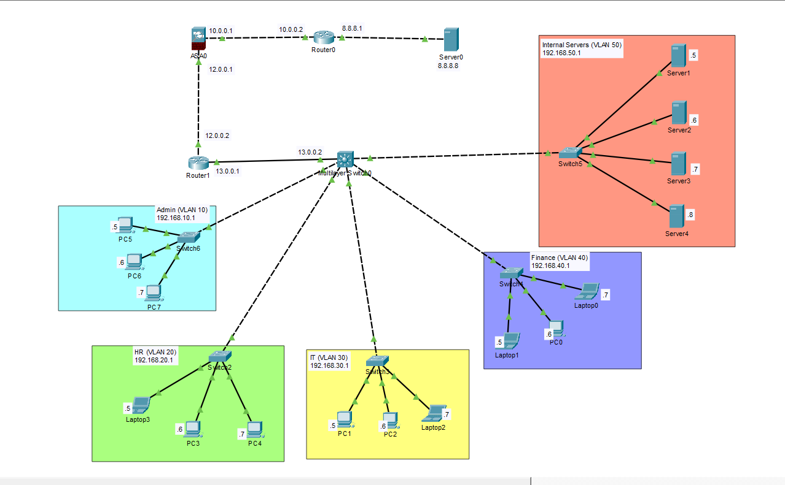

# Enterprise Network Security Design & Implementation

A fully functional, simulated enterprise network built in Cisco Packet Tracer. This project demonstrates a secure "Collapsed Core" architecture, focusing on network segmentation, dynamic routing (OSPF), Edge Firewall integration (Cisco ASA), and a Zero Trust Access Control List (ACL) policy.

## 📸 Topology
 

## 🏢 Network Architecture & IP Scheme
The network is segmented into 5 distinct VLANs to minimize the attack surface and contain lateral movement.

*   **Core Layer:** Cisco 3560 Multilayer Switch handling all Inter-VLAN routing (SVIs).
*   **Edge Layer:** Cisco ASA Firewall providing Security Zones (Inside/Outside) and Dynamic NAT.
*   **Routing:** OSPF Area 0 implemented between the Core Switch and the Edge Router for automatic route convergence.

### VLAN & Subnet Plan
*   **VLAN 10 (Admin):** Gateway `192.168.10.1/24`
*   **VLAN 20 (HR):** Gateway `192.168.20.1/24`
*   **VLAN 30 (IT):** Gateway `192.168.30.1/24`
*   **VLAN 40 (Finance):** Gateway `192.168.40.1/24`
*   **VLAN 50 (Internal Servers):** Gateway `192.168.50.1/24`

## 🛡️ Security Controls Implemented
*   **Strict Access Control Lists (ACLs):** Extended ACLs are applied inbound on the Core Switch SVIs to enforce a Zero Trust model:
    *   **Admin VLAN:** Full access to all internal subnets and the internet (No ACL restriction).
    *   **IT VLAN:** Granted broad administrative access, but explicitly **denied** access to the sensitive Internal Server VLAN.
    *   **HR & Finance VLANs:** Isolated using ACL summarization. They are permitted to access the internet but are strictly **blocked** from accessing any internal `192.168.x.x` subnets (including each other and the servers).
*   **Firewall Hardening (Cisco ASA):** 
    *   Configured Security Levels (Inside = 100, Outside = 0).
    *   Implemented **Dynamic NAT (Network Address Translation)** to hide internal private IPs from the simulated internet.
*   **Trunk Security:** Configured 802.1Q Trunk links between the Core and Access switches to securely carry multi-VLAN traffic.

## 🚀 How to Test This Lab (For Reviewers)
1. Download the `Enterprise-Network-Security.pkt` file and open it in **Cisco Packet Tracer (v8.0+)**.
2. **Test Zero Trust (ACLs):** 
   * Open an **HR PC** and ping the **Finance PC**. *Result: Destination Host Unreachable (Blocked).*
   * Open an **IT PC** and ping the **Internal Server**. *Result: Destination Host Unreachable (Blocked).*
   * Open an **Admin PC** and ping the **Internal Server**. *Result: Success.*
3. **Test Internet Access & NAT:** 
   * Open **any PC** (even HR) and ping the External Web Server (`8.8.8.8`). *Result: Success (Proves OSPF, default routing, and NAT are working).*

## 📂 Repository Contents
*   `Enterprise-Network-Security.pkt` - The working lab simulation file.
*   `topology.png` - Visual network diagram.
*   `configs/` - Text files containing the CLI configurations for the Core Switch, Edge Router, and ASA Firewall.# enterprise-network-security-design

## 🖼️ Proof of Work (ACL Verification)

The Zero Trust ACL policy was verified using ping tests between the various VLANs. Below is the evidence of the security controls in action:

### 1. Admin has full access to the Internal Server
*Admin PC (VLAN 10) successfully pings the Server (VLAN 50).*

### 2. IT is blocked from the Internal Server
*IT PC (VLAN 30) is denied access to the Server (VLAN 50) due to the IT_ACL.*

### 3. HR is isolated from Finance
*HR PC (VLAN 20) cannot reach the Finance PC (VLAN 40), proving ACL summarization works.*

### 4. HR retains Internet Access
*Despite being blocked internally, HR can still reach the public Internet (8.8.8.8) via NAT.*
